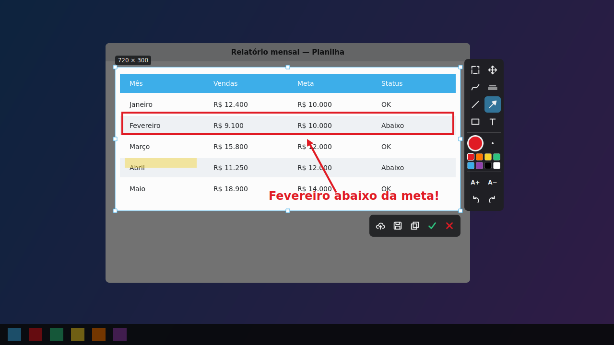
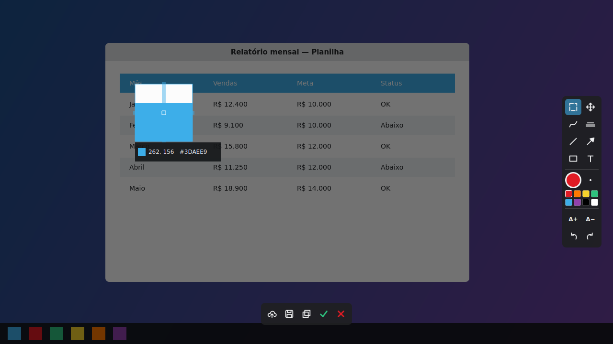
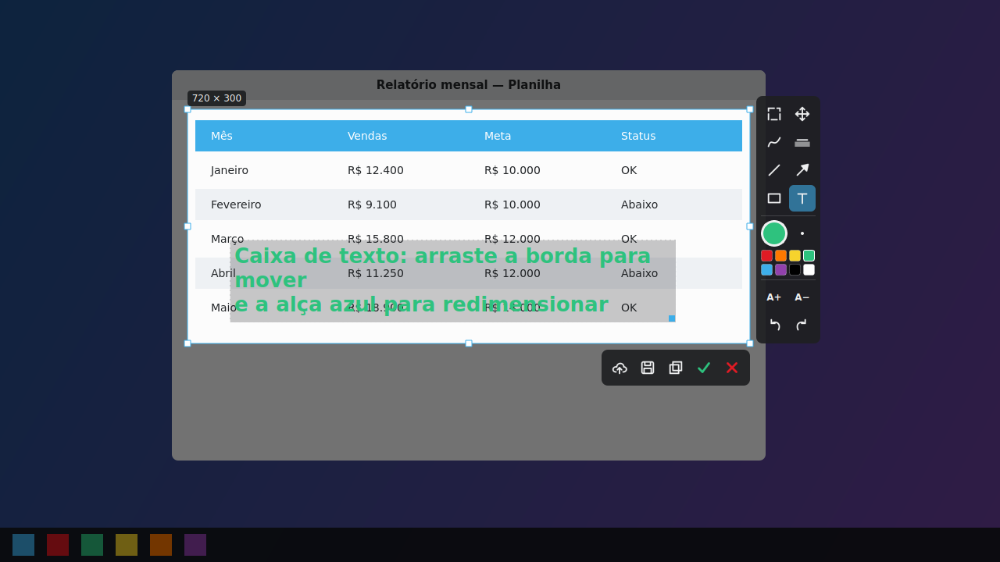
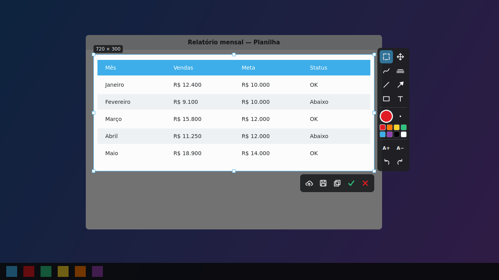
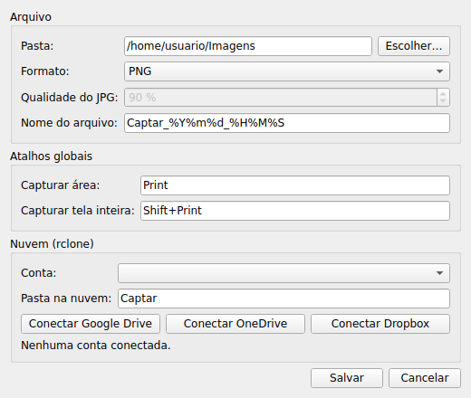

# Captar

Captura de tela com anotações para **KDE Plasma no Wayland** (Fedora), no estilo do Lightshot.

O Captar fica na bandeja do sistema. Ao apertar **Print Screen**, a tela escurece; você recorta uma área, anota por cima e salva, copia ou envia para a nuvem com um link pronto para colar.



## Recursos

- **Seleção ajustável**: 8 alças para redimensionar, arrastar para mover, setas do teclado para ajuste fino e tamanho em pixels no canto.
- **Lupa** com zoom de 8×, coordenadas e cor do pixel (hex) durante o recorte.
- **Ferramentas**: lápis, linha, seta, retângulo, marca-texto e texto. Shift trava linha e seta em 45°.
- **Texto editável**: caixa multilinha que se move, redimensiona e pode ser reeditada depois; cor e tamanho mudam na hora.
- **Mover e apagar** qualquer anotação; trocar a cor ou a espessura de uma anotação já feita.
- **Cores**: paleta rápida com 8 cores e seletor de cor livre; 3 espessuras de traço.
- **Desfazer e refazer** ilimitados (até 100 passos).
- **Salvar** em PNG ou JPG, **Salvar como**, **copiar** para a área de transferência.
- **Nuvem via rclone**: envia para **Google Drive**, **OneDrive** ou **Dropbox** e copia o link compartilhável.
- **Tela inteira** com Shift+Print: salva e copia direto, sem editor.
- **Vários monitores**: uma sobreposição por tela.
- **Configurações**: pasta, formato, qualidade do JPG, padrão de nome e atalhos globais.

| Lupa ao recortar | Caixa de texto |
|---|---|
|  |  |

| Seleção com alças | Configurações |
|---|---|
|  |  |

> As imagens são simulações geradas a partir da própria interface do Captar.

## Instalação (Fedora)

Baixe o RPM em [Releases](https://github.com/mpjsilva/captar/releases) e instale:

```bash
sudo dnf install ./captar-2.0.1-1.fc45.noarch.rpm
```

Dependências instaladas automaticamente: `python3-pyside6`, `python3-gobject`, `xdg-desktop-portal`, `kf6-kglobalaccel` e, como recomendado, `rclone`.

O Captar inicia junto com a sessão. Para abrir na hora, procure **Captar** no menu de aplicativos.

### Rodar sem instalar

```bash
python3 bin/captar
```

## Uso

| Ação | Atalho |
|---|---|
| Capturar área | `Print` |
| Capturar tela inteira | `Shift+Print` |
| Salvar e copiar | `Enter` |
| Copiar | `Ctrl+C` |
| Salvar como | `Ctrl+S` |
| Enviar para a nuvem | `Ctrl+D` |
| Fechar | `Esc` |
| Desfazer / refazer | `Ctrl+Z` / `Ctrl+Shift+Z` ou `Ctrl+Y` |
| Selecionar área | `S` |
| Mover anotação / apagar | `V` / `Delete` |
| Lápis, linha, seta | `P`, `L`, `A` |
| Retângulo, marca-texto, texto | `R`, `M`, `T` |
| Tamanho do texto | `Ctrl+=` / `Ctrl+−` ou `Ctrl+roda` |
| Mover a seleção 1 px / redimensionar | setas / `Shift+setas` |

**Texto:** com a ferramenta Texto, clique para criar ou clique num texto existente para editar; com qualquer ferramenta, dê duplo clique num texto. `Enter` quebra linha; `Esc`, `Ctrl+Enter` ou um clique fora concluem.

## Nuvem

Abra **Configurações…** no menu da bandeja e clique em **Conectar Google Drive**, **Conectar OneDrive** ou **Conectar Dropbox**. O login abre no navegador, e o rclone guarda a conta. Escolha a conta e a pasta de destino; depois, `Ctrl+D` ou o botão de nuvem envia a captura e copia o link.

No Google Drive o acesso é restrito (`drive.file`): o Captar só enxerga os arquivos que ele mesmo enviou. Contas já existentes no `rclone config` desses três serviços também aparecem na lista.

## Estrutura

```
bin/captar            lançador
captar/app.py         bandeja, atalhos globais (kglobalaccel), salvar/copiar/enviar
captar/capture.py     captura via xdg-desktop-portal
captar/overlay.py     sobreposição por monitor, seleção, ferramentas, lupa, desfazer
captar/textbox.py     caixa de texto editável
captar/toolbar.py     barra de ferramentas (vertical) e de ações (horizontal)
captar/shapes.py      formas de anotação
captar/render.py      composição da imagem final
captar/cloud.py       envio via rclone
captar/settings.py    configurações e janela de configurações
captar.spec           empacotamento RPM
```

## Gerar o RPM

```bash
V=2.0.1
mkdir -p build/SOURCES && git archive --prefix=captar-$V/ -o build/SOURCES/captar-$V.tar.gz HEAD
rpmbuild -bb --define "_topdir $PWD/build" captar.spec
```

## Licença

MIT
